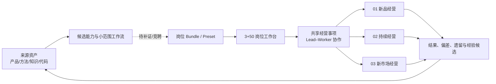

# 三宝无限画布对应的完整方案

版本：2026-10-09
定位：把当前画布表达的经营网络、3+50 数字分身、能力装配和 E2E 价值场景整理成一份可继续决策、可交接、可验收的总体方案。

## 1. 一句话目标

三宝是面向跨境电商出海企业的 Native AgenticOS 设计载体：把已有产品、方法、知识、数据和工作台拆成可回查的能力候选，再按职责组装为岗位工作台和跨岗协作网络，最终用真实证据验证它们是否能解决经营问题。

当前交付是**体系规划与设计证据**，不是已经部署好的 Agent 平台。画布、候选清单、静态样本和浏览器原型都不能代替运行、权限或业务动作证据。

## 2. 总体经营网络

### 2.1 三类关系

| 层 | 解决的问题 | 当前表达 |
| --- | --- | --- |
| 价值创造 | 企业如何发现机会、兑现价值并持续经营 | 新品经营、持续经营、新市场经营 |
| 经营治理 | 谁在什么范围内定方向、配资源、做取舍 | 目标、责任、授权、结果和遗留责任 |
| 能力供给 | 专业判断和工具如何被可靠地提供 | 3+50、Skill、知识、数据、工作台和平台支撑 |

三层属于同一张网络，不建立三套独立产品。价值创造主链可以相交、接力和回流；治理和能力供给为三条主链提供共同约束与支持。

### 2.2 总链

实线表示已确认的设计关系；虚线表示尚未通过候选收件和验证的组装关系。

## 3. 三条经营主链

### 3.1 01 新品经营

**核心问题**：一个新品是否值得继续投入，以及在什么明确范围内可以接续持续经营。

**已确认骨架**：消费者需求洞察（C-018）→ 商业论证（C-021）→ 产品定义（C-023）→ 实现（C-025）→ 验证（C-026）→ 上市经营策划（C-027）→ 准入、供给、渠道与可售核验（C-028—C-031）→ 按范围接续（C-042）。

**判断框架**：客户价值、兑现能力、经营可行性（C-012）。不设未经决定的统一总分、阈值或自动放量。

**业务检验镜头**：VOC 主线。需求证据与问题地图交给商业论证，再接收产品、上市和持续经营反馈。VOC 是验证镜头，不是新增主链。

### 3.2 02 持续经营

**核心问题**：需求变化后，供给、渠道／触达、客户承诺和现金占用怎样联动调整。

**已确认首个场景**（C-043—C-049）：需求变化判断与未来情景 → 有条件的供给与交付方案 → 市场侧候选条件 → 经营经济性与现金影响 → 联动选项比较 → 依赖就绪 → 主责查看 → 按范围收尾与遗留责任。

**关键边界**：预测不是供给承诺，销量不是完整需求，候选选项不等于可执行动作；局部收尾不自动结束整个事项。

**业务检验镜头**：Shopify AI+BI 智能运营工作台。经营数据、NLP／情感等能力可作为分析输入和候选技能来源，但不能跳过口径、来源、授权和效果验证。

### 3.3 03 新市场经营

**核心问题**：进入一个新国家、区域、平台或用途范围，需要先证明什么，怎样控制范围化风险并形成可接续的首个经营闭环。

**统一入口**：从 C-011 的新市场经营全景卡开始，与新品、持续经营保持同样的“总览 → 事项 → 责任卡 → 能力候选”结构。

**建议的设计路径**：新市场进入问题与范围说明 → 商业论证 → 产品／宣称／准入判断 → 上市安排 → 供给与交付 → 渠道发布与可售核验 → 首单及持续经营接续。每一段都按国家、市场、平台、版本和宣称范围保存依据。

**当前状态**：高层入口和卡片全景已经补齐；具体国家样本、市场证据、真实平台动作、完整候选包和运行验证仍未完成。德国 Amazon 的 M5 Smart 例子只能作为一个范围化样本，不能外推成所有市场结论。

## 4. 3+50 数字分身模型

### 4.1 三个管理层分身

3 个管理层分身代表方向、资源和治理边界的决策权来源。它们回答“企业要往哪里去、资源约束是什么、出现重大例外时谁作取舍”，不自动等同于 Lead、审批人、授权人或运行 Agent。

### 4.2 五十个岗位能力

50 个逻辑岗位按四个责任平面组织：

- 经营管理：5；
- 业务运营：35；
- 独立控制：5；
- 数据与 Agent 平台：5。

画布中每个位置应显示**姓名／别名 + 完整岗位名称 + 要解决的问题 + 交付物**。姓名和岗位只是可读的身份映射，不证明已经任命、具备资格、拥有权限或已经运行。

### 4.3 岗位如何被装配

先定义职责标准和交付验收，再根据已验证能力、必要资格、资源和有效授权安排人、Native Agent 或协作组合（C-017）。不能因为一个 Skill 已登记，就推定岗位胜任；也不能因为出现一个数字头像，就推定可以做真实动作。

## 5. 共享经营事项与协作模型

共享经营事项（C-014）是跨岗协作的最小业务单元。每个事项至少关联：

1. 目标与责任；
2. 验证与证据；
3. 决定与资源；
4. 行动与结果。

一个事项保留一个端到端经营主责，同时允许多个可复用专业 Worker 从自己的工作台参与。Lead 负责范围、选项、依赖和取舍的可读性；Worker 负责专业判断、条件、交付和反馈。共同五个对照面是语义骨架，不强行变成统一 Schema、统一流程或统一权限。

授权按 C-016 明确责任角色、对象、动作、资源、时间和前提。变化按 C-015 先核对来源与影响；前提失效、越界或新反证出现时，只暂停受影响的边界并回到有权责任方复核。

## 6. Skill、Bundle、Preset 与工作台的装配链

### 6.1 六级装配

1. **来源资产**：仓库、文档、方法、代码、知识库和已有工作台；
2. **原子能力候选**：解决一个清晰子问题，声明输入、输出、依赖和边界；
3. **小范围工作流**：把若干能力在一个明确任务范围内组合，保留交接和停止线；
4. **岗位 Bundle／Preset**：按岗位职责和 Playbook 组装，明确可用范围；
5. **岗位工作台**：常规业务产品、知识库、工具和候选 Agent 的可读入口；
6. **跨岗 E2E**：多个岗位在同一共享事项中协作，结果回到事项并形成经验候选。

### 6.2 候选状态闸门

候选登记、源码定位、preview、合成样本、候选提交包、Skill、Preset、Runtime 和真实业务动作必须分开。C-376 的收件闸至少要求：自有版本、两个具名 C 地址样本、输入输出锚点、交接与 RETURN、失败隔离、停止反例。缺证时状态是 `RETURN／待补证`。

当前点名候选 `SANBAO-a2b41a57-优化决策` 仍是候选能力池记录，不是已生效 Preset。其来源片段可定位且实现文件可做静态语法检查，但还没有完成自有版本、具名地址样本、完整 I/O、交接和运行证据。

## 7. 两个 E2E 价值场景

### 7.1 VOC 需求证据主线

**输入**：多源客户声音、报告结构、问题范围和来源定位。
**核心交付**：可回查的需求证据与问题地图。
**主要接收方**：商业论证、产品定义和上市经营。
**回流**：补证请求、验证结果、实际偏差与经营经验候选。
**不能直接推出**：客户价值成立、产品成功、市场份额、NPS 或自动投入决定。

### 7.2 Shopify AI+BI 智能运营工作台

**输入**：Shopify 经营数据、口径与对象关系、NLP／情感／关键词等候选分析能力。
**核心交付**：范围化的需求变化、增长或收入判断，连同依据、条件、未知和可能的联动选项。
**主要接收方**：持续经营事项 Lead、供给／渠道／现金等 Worker。
**回流**：实际执行、结果偏差、数据质量问题、方法改进和经验候选。
**不能直接推出**：自动调价、投放、补货、支付、结算或真实订单动作。

两个场景是产品验证镜头，不是新的经营主链；它们必须落回同一事项、同一授权和同一证据规则。

## 8. 数据、知识与证据层

- C-019／C-020：需求对象、证据、用途、范围和验证缺口分开；
- C-039：数据供给带来源、版本、覆盖和质量说明；
- C-040：经营口径与对象关系有责任方、适用范围和历史；
- C-050：经验候选关联情境、原证据、边界和待验证主张；
- C-051：共用经营知识整理与维护，保留专业归属和核验状态；
- C-052—C-055：方法候选、制作、验证和范围化生效分别记录。

原始事实、专业判断、候选主张、正式决定和运行结果不能写成同一种“知识”。知识整理也不自动发布、扩权或变成 SOP。

## 9. 产品分层和实现边界

| 层 | 当前应承担的职责 | 当前不应推定 |
| --- | --- | --- |
| 画布层 | 总览、关系、卡片下钻、决策沿革和阅读路径 | 生产系统、任务引擎、权限中心 |
| 事项协作层 | 共享事项、Lead／Worker、证据和交付回流 | 自动派单、自动取舍 |
| 岗位工作台层 | 职责、输入、输出、知识和候选工具 | 已任命数字员工 |
| 知识／资产层 | 来源、版本、适用范围、维护和核验 | 所有知识都已可信 |
| 能力编排层 | Skill、工作流、Bundle、Preset 的候选组装 | 候选已运行或有业务权限 |
| 执行／证据层 | 授权动作、真实输入输出、日志、结果和独立验收 | 由静态页面自动生成 |

Harness（DeepSeek Harness、Codex 或其他方案）仍留到下一阶段重新讨论；当前不因为画布表达而锁定底座、模型、部署或 API。

## 10. 当前最大缺口与优化优先级

### P0：必须先补的闭环

1. 为点名候选补齐 C-376 的自有版本、两个具名 C 地址样本、I/O、交接、RETURN、失败隔离和停止反例；
2. 为三条主链补齐可对照的首接交付和接收方阅读合同，尤其保持新市场从 C-011 全景进入；
3. 把 3+50 的姓名、岗位、职责标准、交付验收和授权边界形成可审计的 roster，不把头像当运行证明；
4. 为 VOC 与 Shopify AI+BI 各选一个可回查的最小 E2E 样本，明确输入、输出、责任、证据和停止条件。

### P1：形成可复用的装配机制

1. 定义原子 Skill 的版本、输入输出合同、依赖、适用范围和回滚／RETURN 语义；
2. 定义小范围工作流如何组合而不吞并专业判断；
3. 建立 Bundle／Preset 的候选竞聘、验证、生效和退役记录；
4. 建立事项级结果、偏差、遗留和经验候选回流。

### P2：进入受控运行前的基础设施

1. 确认数据真源、口径、窗口、权限和审计；
2. 建立 Agent 运行日志、成本、延迟、失败和人工接管指标；
3. 设计独立验收和受控业务动作环境；
4. 再讨论 Harness、模型、部署与跨系统连接。

## 11. 分阶段路线图与 Tickets

| 阶段 | 目标 | 主要输出 | 完成标准 |
| --- | --- | --- | --- |
| A 总图骨架 | 保持三层关系、三主链、共享事项和 3+50 可读 | 画布总览与 Playbook | 三主链同一入口，关系方向可读 |
| B 主链接口 | 补齐三条首接交付和 Lead／Worker 边界 | 三份交接卡 | 输入、输出、接收和回流可回查 |
| C 3+50 roster | 给每个逻辑岗位补姓名、岗位名、问题和交付 | roster／岗位卡 | 50/50 位置可读，仍标候选与未运行 |
| D 两个 E2E | 用 VOC、Shopify AI+BI 验证交接设计 | 两份最小样本 | 每个样本都有证据、停止和回流 |
| E 候选收件 | 通过 C-376 补证并审查点名候选 | candidate package | 未补齐就 RETURN，不进入 Preset |
| F Preset 试装 | 在小范围任务中装配候选能力 | Bundle／Preset 设计包 | 方法、版本、范围、验收和回滚明确 |
| G 受控运行 | 在授权环境验证真实输入输出 | 运行日志与独立验收 | 运行、结果、权限和业务动作分别有证据 |

下一批建议 Tickets：

- `T-01`：补齐 `SANBAO-a2b41a57-优化决策` 的 C-376 提交包（当前仍为 `RETURN／待补证`）；
- `T-02`：已完成，三张首接交付卡统一为五面阅读合同；
- `T-03`：已完成，3+50 roster 已带姓名、完整岗位名、来源和设计态边界；
- `T-04`：已完成，VOC 与 Shopify AI+BI 各有一份最小可回查 E2E 设计样本；
- `T-05`：已完成，`origin/main` 已核对到 `a1d8996c0ccfe484db4b5b37706fae218bc854eb`；
- `T-06`：已完成，浏览器结构、交互和移动／桌面视口检查通过。

当前唯一未完成项仍是 T-01；它需要候选自身提交独立版本化包和至少两个真实具名地址样本，项目不能代交。

### C-376 叶页复核补记（2026-10-10）

C-376 现在同时承担两件事：一是六面收件审查，二是把模块之间“能连到哪里、哪里被证据挡住”说清楚。六面分别检查身份、输入、处理、样本、交接和停车；当前读数仍为 `0／6`，全部回到点名候选自提交，不改变 T-01 的 `RETURN／待补证` 状态。叶页内的三组关系只用于读图和设计追踪，不是主画布数据流、岗位任命、Preset 生效或 Runtime 运行证明。主 SVG、`nodes`、`relations`、三条主链及 C-312 入口保持不变。

## 12. 事实状态表

| 内容 | 当前状态 | 不能推定 |
| --- | --- | --- |
| 三层经营网络与 C-011 三主链 | 已确认设计 | 已运行平台 |
| 3 个管理层 + 50 个岗位能力位 | 已确认高层站位 | 已任命、已授权、已部署 |
| Lead–Worker 共享经营事项 | 已确认设计接口 | 自动派单或自动取舍 |
| VOC 与 Shopify AI+BI | 业务验证镜头 | 已证明商业成功 |
| 点名候选 `SANBAO-a2b41a57-优化决策` | 候选登记与来源定位 | 已提交、已验证、已生效 Preset |
| 无限画布原型 | 可读性优化后的设计载体 | 正式产品功能或生产验收 |
| Harness | 未锁定 | DeepSeek 或 Codex 已是最终底座 |

## 13. 最终验收口径

这份方案完成的标志，不是页面上出现更多卡片，而是任何一个人都能从总图走到一张具体卡，并回答：

> 我现在看的是哪个经营问题？谁负责？输入从哪里来？交付给谁？凭什么接收？哪些证据还缺？如果继续做，授权和停止条件在哪里？

当这些问题可以逐项回查，3+50 的能力空位、三条主链的协作接口和两个 E2E 场景才真正形成可执行的设计基础。是否进入运行，仍需经过候选收件、方法验证、权限确认、受控执行和独立验收。
